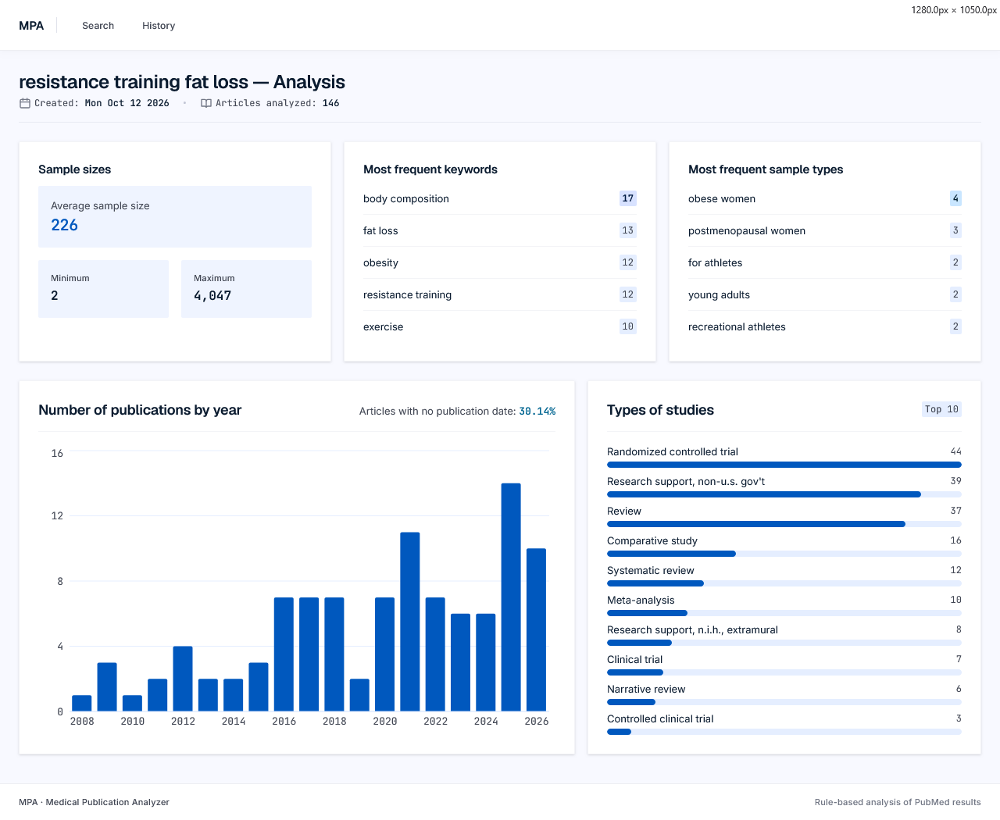
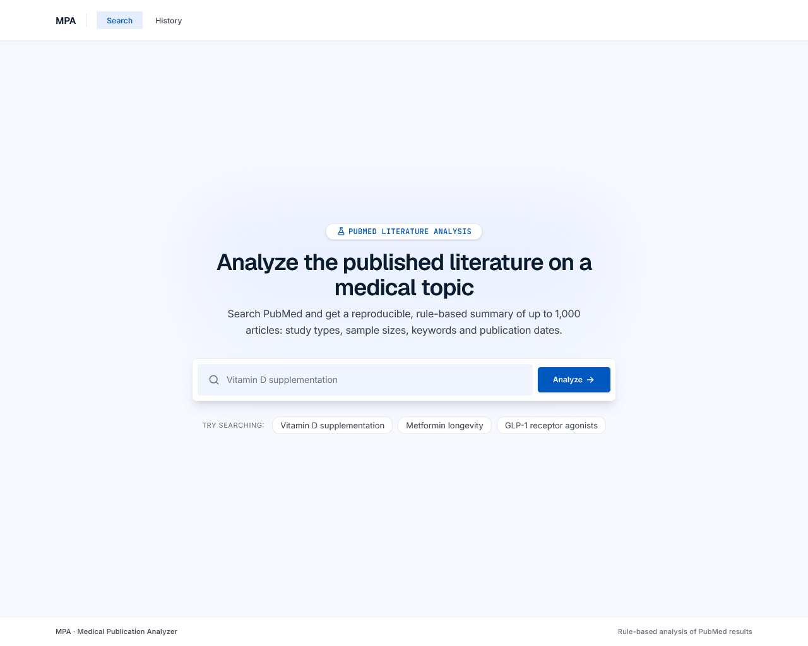
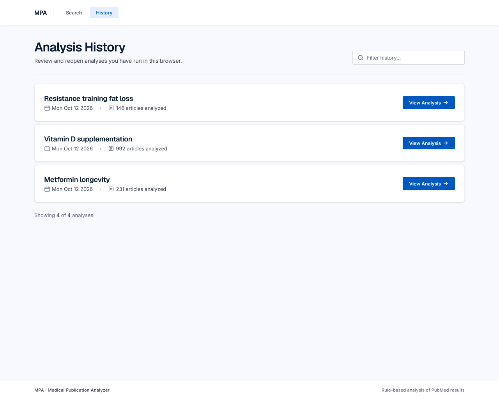

# MPA – Medical Publication Analyzer

Search a medical topic and get an aggregated analysis of PubMed literature – publication timelines, study types, sample sizes, keyword frequencies, and more. MPA fetches articles via the NCBI E-Utilities API, extracts methodological data from abstracts, titles, and article metadata using rule-based parsing, and presents the results as interactive charts.

## Screenshots

There is no hosted demo – running the app needs a local PostgreSQL database and an NCBI API key (see [Setup](#setup)) – so here is what it looks like.

**Analysis** – the result for one topic: sample size summary, most frequent keywords and study populations, publications per year, and the most common study types.



| Search | History |
| --- | --- |
|  |  |
| Enter a topic, or start from an example query. An analysis of up to 1,000 articles takes several seconds. | Past analyses are kept per browser and reopen instantly, with a filter to find one by topic. |

## Why this exists

Researchers reviewing biomedical literature typically scan dozens of abstracts manually to understand what's been studied, with which methods, and where the gaps are. AI-powered tools like Consensus, Elicit, PubMed.ai, and Scholarcy help with discovery and summarization – and some can aggregate findings across publications – but they rely on opaque language models, so you can't inspect why a given paper was classified a certain way or reproduce the exact same result twice.

This app takes a different approach: deterministic, rule-based extraction. Every classification and every number comes from explicit pattern-matching against the article text and metadata, not from a language model. The tradeoff is lower recall on unusual phrasing, but the result is fully reproducible – the same input always produces the same output, and the extraction logic is inspectable.

## Architecture

```
apps/
  backend/    Express 5 REST API  (TypeScript)
  frontend/   React 19 SPA        (TypeScript, Vite)
packages/
  shared/     Shared types (AnalysisResult)
```

**Backend** – fetches and parses PubMed data (ESearch → EFetch), extracts structured features from articles (publication type, sample size, sample type), aggregates the results, and persists them in PostgreSQL (JSONB). Exposes a REST API with OpenAPI/Swagger docs.

**Frontend** – React Router SPA with three views: search, analysis results (with Recharts histograms), and analysis history.

## Prerequisites

- Node.js (v20+)
- PostgreSQL
- An NCBI API key ([request one here](https://ncbiinsights.ncbi.nlm.nih.gov/2017/11/02/new-api-keys-for-the-e-utilities/))

## Setup

### Database

Create a PostgreSQL database and run the schema:

```bash
createdb literature_analyses
psql -d literature_analyses -f apps/backend/src/db/db.schema.sql
```

### Backend

```bash
cd apps/backend
npm install
```

Create a `.env` file:

```
PORT=8080
NCBI_API_KEY=<your-key>
DB_URL=postgresql://<user>:<password>@localhost:5432/literature_analyses
```

Start the dev server:

```bash
npx ts-node-dev src/server.ts
```

The API runs at `http://localhost:8080`. Swagger UI is available at `/swagger`.

### Frontend

```bash
cd apps/frontend
npm install
npm run dev
```

Opens at `http://localhost:5173` by default.

## API Endpoints

All routes are under `/api`.

| Method   | Path                     | Description                          |
| -------- | ------------------------ | ------------------------------------ |
| `GET`    | `/health`                | Health check                         |
| `POST`   | `/analyses`              | Create or retrieve analysis by term  |
| `GET`    | `/analyses`              | List all analyses for a client       |
| `GET`    | `/analyses/:analysisId`  | Get a single analysis by ID          |
| `DELETE` | `/analyses/:analysisId`  | Delete an analysis                   |

All analysis endpoints require a `client-id` header.

## Analysis Scope

The app uses rule-based extraction on article abstracts and metadata to produce the following:

- **Publication timeline** – article counts grouped by year
- **Study type classification** – identifies ~20 publication types from abstracts, including RCTs, systematic reviews, meta-analyses, cohort studies, observational studies, case reports, and more
- **Sample population detection** – recognizes human study populations (e.g. patients, athletes, children, workers) and descriptive subgroups (e.g. "adults with disabilities", "women with diabetes")
- **Sample size extraction** – pulls numeric sample sizes from common reporting patterns (e.g. "n = 120", "45 participants")
- **Keyword frequency** – top MeSH terms and author keywords
- **Aggregated statistics** – total article count, sample size summary (min/max/average)

## Tech Stack

| Layer    | Technology                              |
| -------- | --------------------------------------- |
| Frontend | React 19, React Router 7, Recharts, Vite |
| Backend  | Express 5, TypeScript, fast-xml-parser  |
| Database | PostgreSQL (pg driver, JSONB storage)   |
| API Docs | Swagger UI / OpenAPI via swagger-jsdoc  |
| External | NCBI E-Utilities (ESearch + EFetch)     |

## Planned Improvements
 
- **User authentication** – replace the current UUID-based client identification (generated and stored in localStorage) with proper registration and login, so analyses are tied to real accounts
- **Result filtering** – filter analyses by publication year range, journal, or keywords before and after running an analysis
- **Data export** – export analysis results as CSV or JSON for use in spreadsheets or other tools
- **Configurable analysis parameters** – let users control the number of articles fetched and the date range before running a query
- **Corpus caching** – cache raw PubMed responses in the database so repeated queries on the same topic don't re-hit the API, improving speed and reproducibility
- **Evidence traceability** – link each extracted value (sample size, study type) back to the source sentence in the abstract, with a direct PMID link, so every data point is verifiable
- **Coverage reporting** – show per-field extraction rates (e.g., "sample size found in 62% of articles") so users know how complete the analysis is
- **Extraction evaluation** – benchmark the rule-based parser against a hand-annotated set of abstracts, reporting precision and recall per extraction category
- **Test coverage** – add unit and integration tests for the extraction pipeline and API endpoints
